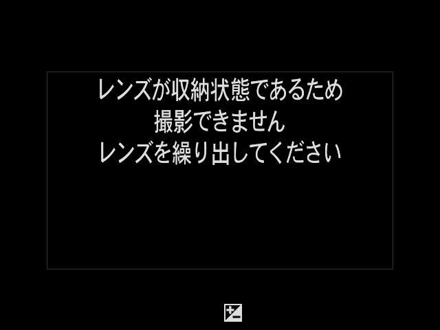
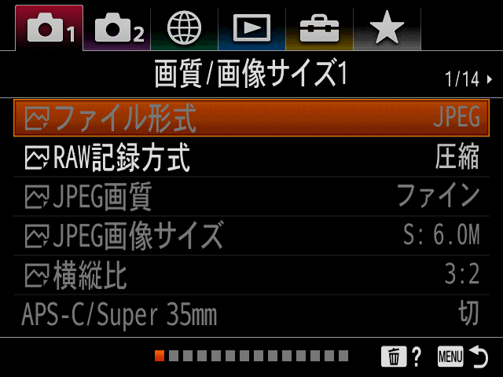

# A7C QEMU（ILCE-7C 2.03）

在 Linux 电脑的独立 QEMU 中运行 Sony A7C 2.03 原厂应用，进入原拍摄页面并打开原 MENU。工程参考 ZV-E10／A7M3，使用 A7C 自己的更新包、Linux 源码、设置模板、字体和界面资源。

**当前已实际验证原拍摄页入口、MENU、返回拍摄页和再次进入 MENU。** 拍摄页会显示原厂“镜头处于收纳状态，无法拍摄”的提示；镜头状态、完整取景和拍摄没有模拟。主机窗口显示原应用生成的像素。

| 原拍摄页（当前带镜头提示） | 原 MENU |
| --- | --- |
|  |  |

## 启动

本工作区构建和固件资产已就位。在本目录执行：

```bash
./start.sh
```

窗口的 **MENU** 按钮／`M` 打开菜单，**返回**／`Esc` 恢复拍摄页，**刷新**／`R` 重新请求原生帧。每轮日志和截图在独立 `output/<时间>/`。关闭窗口通过 QMP 正常结束本轮 QEMU；失败会保留进程归属，可再次关闭重试。

首版只提供这三个已验收的控制。ENTER 的原始映射和单次提示已研究，但有一轮真实窗口等待超时，确认键／菜单参数修改未作为稳定功能交付。

从零准备需要 Linux x86_64、Python 3.12+、Pillow／Tk／pyelftools／Capstone、Bootlin ARM 工具链及构建依赖。完整步骤见 [docs/setup.md](docs/setup.md)。不会执行 Windows 更新器，不连接真实相机或 SD。

## 验证范围

| 项目 | 实际状态 |
| --- | --- |
| 原更新包 | ILCE-7C 2.03，型号 `0x91030019`，CXD90045／ARM32 EABI5；完整 EXE／CAB／DAT 摘要固定 |
| 独立机器 | 实际构建 `-M a7c`，Cortex-A9、九个 Sony timer、PL011；guest 无网卡或磁盘 |
| 内核与原模块 | 从 A7C 官方源码构建 `3.0.27_nl-rt106+`；本阶段所需原模块全部实际加载 |
| 原应用 | 原 `bootin.elf → im.elf`，原页面、文字、图片和条目实际消费 |
| 主页面与 MENU | 原拍摄页入口、六分类菜单可见；返回与重入的像素分别与之前相同 |
| 绘图 | 实际消费 Bitmap／A8／LZ77／Morton、纹理线性缩放、局部清屏、present 和原完成通知 |
| 输入 | MENU 原按下／释放，菜单调度与页面恢复通过原 API；完整硬件输入路由未宣称恢复 |
| 镜头／CMOS／AF／拍照录像 | 未实现，`capture_verified=false` |
| Sony 物理 ASIC 等价性 | 未验证；设备与软件绘图属于明确的本机功能模型 |

取帧等待原生产者完成，在原 Bitmap 读锁下复制并固定快照页，经 QMP 按实际 PFN 读取，独立校验指纹、SHA256 和 PNG。原始失败与后继成功分别保留，验收记录见 [validation/ui-acceptance.json](validation/ui-acceptance.json)。

## 全部官方源码

官方页面：<https://oss.sony.net/Products/Linux/DI/ILCE-7C_Ver203.html>

页面列出的 **26 个源码包已全部下载**到 `sources/sony-ilce7c-ver203/`，共 **271,399,908 字节**（4 个 tar.gz、22 个 src.rpm），不同版本均保留；页面和 Sony notice 也已归档。主会话已独立读回全部 SHA256。

```bash
python3 scripts/download-sources.py
(cd sources/sony-ilce7c-ver203 && sha256sum -c SHA256SUMS)
```

[完整下载清单](validation/source-downloads.json) · [来源与固定输入](SOURCES.md)。这些是 Sony 公开的开放源码包，不包含专有相机应用的完整源代码。

## 回归与复验

```bash
python3 tests/run-tests.py
python3 scripts/download-sources.py --self-test
./start.sh --smoke
```

`--smoke` 保存主页面、MENU、按键后画面、返回和重入，并正常关闭 QEMU。对本次实际成功轮可独立复验：

```bash
python3 tests/check-runtime-evidence.py output/20261106-233800
```

[原生窗口验收](validation/gui.json)和[完整主机回归](validation/host-tests.json)均已通过；宿主独立核对两轮共 8 份原像素与 PNG，两个 QMP 退出码均为 0。

固件、解包程序、设置和运行日志只保留在本机忽略目录，公开源码不混入这些资产。[第三方许可](THIRD-PARTY.md) · [UI ABI／绘图适配](source/ui/PORTING.md) · [问题与原始失败](report/2026-11-06-a7c-qemu-bringup/PROBLEMS.md)。
